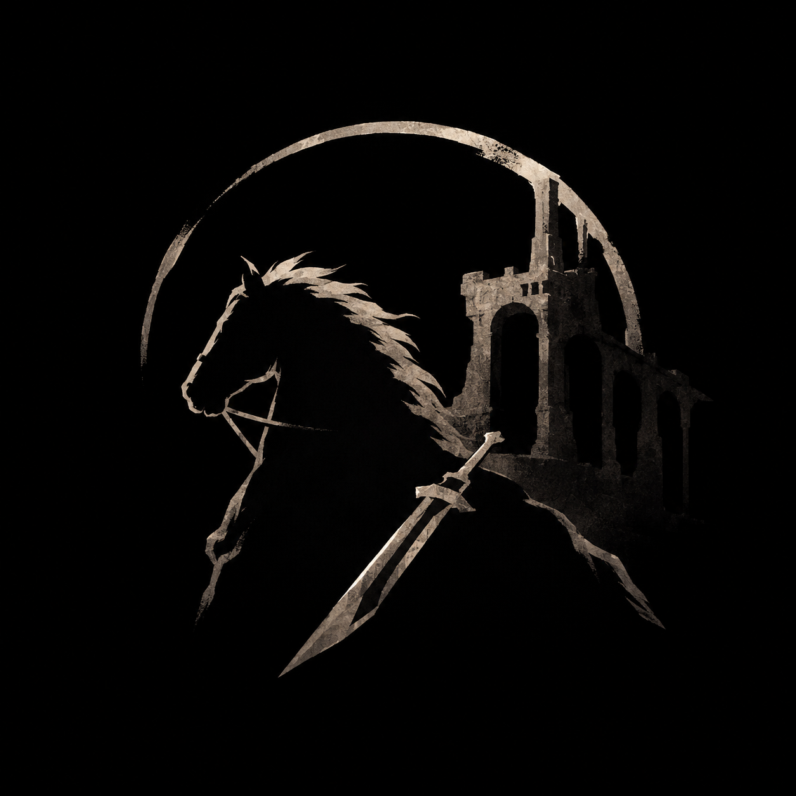
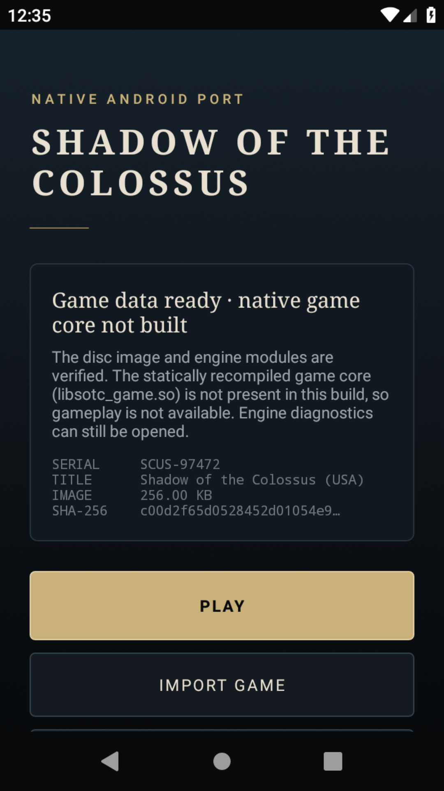

<p align="center">
  
</p>

<h1 align="center">Shadow of the Colossus Mobile</h1>

<p align="center">
  A native Android port project for the original PlayStation 2 release of <em>Shadow of the Colossus</em>, built around static recompilation and native ARM64 execution rather than a general-purpose PS2 emulator.
</p>

<p align="center">
  <a href="https://github.com/zoddrun/Port-SotC-Mobile">Repository</a>
  ·
  <a href="https://github.com/zoddrun/Port-SotC-Mobile/releases">Releases</a>
  ·
  <a href="docs/COMPATIBILITY.md">Compatibility</a>
  ·
  <a href="docs/BUILDING.md">Build Instructions</a>
</p>

<p align="center">
  <strong>Status:</strong> Development (host + packaged runtime) · <strong>Playable now:</strong> No · <strong>Latest release:</strong> <a href="https://github.com/zoddrun/Port-SotC-Mobile/releases/tag/v0.3.0-alpha.1">v0.3.0-alpha.1 HD Presentation and Controls Preview</a>
</p>

> **Important:** This project is in active development and is **not playable yet**. The Android host application, disc import/validation, input, rendering/audio foundation, diagnostics, HD shader pack installer and statically recompiled ARM64 runtime are implemented and packaged, but no physical ARM64 device has loaded this build. No gameplay, boot, rendering, audio or device compatibility is claimed without evidence.

## Overview

**Shadow of the Colossus Mobile** (repository: [Port-SotC-Mobile](https://github.com/zoddrun/Port-SotC-Mobile)) aims to bring the original PlayStation 2 game to Android through **static recompilation** and native execution.

Instead of bundling or launching a PS2 emulator, the long-term goal is to run a game-specific, recompiled ARM64 core on Android with a native host layer for rendering, audio, input, storage, lifecycle, and user interface. The project is being developed for the USA retail release **`SCUS-97472`** first.

## Current Project Status

| Area | Status | Notes |
| --- | --- | --- |
| Overall project stage | **Development (host foundation)** | Core Android host implemented; end-to-end playable port not yet complete. |
| Native game core availability | **Built, not yet run** | The ARM64 `libps2EntryRunner.so` is built, stripped, verified and packaged in the APK; no ARM64 device has loaded it. The recompilation pipeline reached `PIPELINE_DONE` on 2026-11-18. |
| Android app/host foundation | **Implemented; partially verified** | Kotlin app, ISO import/validation, EGL/GLES 2-3 host (ES 3 requested, ES 2 automatic fallback), AAudio path, touch/gamepad input, categorized settings, real performance controls, diagnostics, and core-loader boundary exist. |
| Emulator/runtime checks (host integration) | **Verified on x86_64 Android emulator (API 28, SwiftShader)** | Install/launch, AAudio, settings, controller screen, SAF import, EGL 1.4 init, the ES 2 renderer fallback, the GPU capability query, adaptive resolution, the low-memory path and preset persistence were verified on 2026-11-19. The image reports only OpenGL ES 2.0, so the ES 3 path itself is unverified (see [Compatibility](docs/COMPATIBILITY.md)). Not a device or gameplay benchmark. |
| Physical ARM64 device testing | **Not verified** | No ARM64 hardware validation has been completed. |
| Verified gameplay | **Not available** | No boot/title/gameplay verification on Android yet. |
| Current release | **v0.3.0-alpha.1 — HD Presentation and Controls Preview** | Host application, bundled original shader pack, refined controls UI and packaged ARM64 runtime; **not playable** (no physical device evidence); debug-signed development build. See [release notes](docs/releases/v0.3.0-alpha.1.md). |

## Key Features

### Implemented (host foundation)

- Native Android application (Kotlin) with C++20/NDK native host; installed label `SOTC`.
- ISO import via Android Storage Access Framework (SAF) with copy, validation, progress/cancellation, atomic publish, and recovery logic.
- Disc validation for **SCUS-97472** (ISO9660, `SYSTEM.CNF`, PS2 ELF, required XFF modules).
- EGL/OpenGL ES 2-3 rendering host (ES 3 requested, ES 2 automatic fallback) and AAudio output path.
- Product launcher with a single primary Play action (disabled unless the runtime is present), game details, and no diagnostic launch path.
- Categorized settings (General, Graphics, Performance, Audio, Controls, Storage, Advanced) with honest availability notes.
- Diagnostic scene/status reporting when no game core is available (explicitly labeled; not gameplay).
- On-screen PS2-style touch controls with multitouch, Classic/Modern/Compact/Custom presets, deadzone, camera sensitivity, inversion, and layout editing.
- Physical gamepad input handling, hot-plug detection, automatic touch-control hiding, and controller settings.
- Versioned host/core ABI boundary (`app/src/main/cpp/sotc_game_api.h`) for future core integration.
- Developer-supplied launcher icon integrated as Android adaptive resources.

### Planned / in progress (not yet verified)

- Completed static recompilation pipeline output for the supported game release.
- ARM64 cross-compiled, packaged game runtime/core integrated into the Android app.
- Original game boot, rendering, and audio on Android.
- Verified touchscreen and USB/Bluetooth gamepad gameplay control.
- Save persistence and lifecycle behavior during real gameplay.
- Graphics/performance tuning for mobile devices.
- Reproducible, tested installable APK releases.

## Required Game Version

The initial supported target is:

- **Game:** Shadow of the Colossus
- **Platform:** PlayStation 2 (original retail disc image)
- **Region:** USA (NTSC-U)
- **Serial:** `SCUS-97472`
- **Expected boot executable:** `SCUS_974.72`
- **Required modules:** `KERNEL.XFF`, `MANAGER.XFF`, `GAMECORE.XFF`

Different regional releases or modified images may contain different executable code, module data, addresses, and function mappings. **A generic PS2 ISO is not compatible.** PAL, Japanese, preview, translated, repacked, or modified releases are **not verified/supported** unless independently implemented and validated.

See [docs/COMPATIBILITY.md](docs/COMPATIBILITY.md) for full requirements, validation behavior, and status definitions.

## Compatibility

- **Target Android ABI:** `arm64-v8a` (shipping target)
- **Minimum Android version:** Android 9 (API 28)
- **Target/compile SDK:** 34
- **Graphics requirement:** OpenGL ES 2.0 minimum (ES 3 used when available; `Force OpenGL ES 2.0` is available in Settings → Graphics). Vulkan is not implemented.
- **Physical controller:** Optional (touchscreen required by manifest)

Detailed compatibility, verification evidence, and limitations: [docs/COMPATIBILITY.md](docs/COMPATIBILITY.md).

## Installation

1. Download the latest development preview from [GitHub Releases](https://github.com/zoddrun/Port-SotC-Mobile/releases) (`v0.3.0-alpha.1` is the current HD presentation and controls preview).
2. Install the APK on a compatible Android device (you may need to allow installation from your chosen source).
3. Launch the app and use **Import Game** to select your own legally obtained `SCUS-97472` ISO image via the system file picker.
4. Wait for copy/validation/extraction to complete.

> The app does **not** include game data, BIOS files, copyrighted assets, or a playable game. The ARM64 runtime is packaged and passes static verification, but it has never run on a device. Importing a supported disc image does not make the game playable. The published alpha is a development preview, not a playable release.

Full instructions: [docs/INSTALLATION.md](docs/INSTALLATION.md).

## Controls

- **Touchscreen:** Virtual PS2-style controls (D-pad, analog sticks, face/shoulder buttons, Start/Select, L3/R3) with multitouch, Classic/Modern/Compact/Custom presets, radial deadzone, camera sensitivity, inversion, and layout editing. The gameplay window has its own native overlay inside the recompiled runtime (patch 0005); it compiles for ARM64 but has not run on a device, so in-game touch control is unverified.
- **Physical controllers:** USB/Bluetooth gamepads are handled by the host input layer and by the runtime's own raylib gamepad path, including hot-plug detection and optional hiding of the touch overlay; hardware/gameplay verification is pending.
- **Customization:** Touch layout editor, camera sensitivity, deadzone, inversion, and controller settings exist in the app.

Details and mappings: [docs/CONTROLS.md](docs/CONTROLS.md).

## Screenshots and Media

<p align="center">
  
</p>

<p align="center"><em>Host application main screen (v0.1.0-alpha.1, API 28 x86_64 emulator, synthetic test disc). This is the host UI, not gameplay.</em></p>

No verified Android gameplay screenshots are available yet.

- Application/diagnostic screenshots are added to [`docs/media/`](docs/media/) only when captured from the actual app build.
- **Gameplay screenshots will be added only after verified native Android gameplay is running.** Console screenshots, concept art, or AI-generated images will not be presented as Android port gameplay evidence.

## Building from Source

Prerequisites include JDK 17, Android SDK (API 34), Android NDK `26.1.10909125`, and CMake `3.22.1`. A local, untracked `local.properties` with `sdk.dir` is required.

```bash
./gradlew testDebugUnitTest --console=plain
./gradlew lintDebug --console=plain
./gradlew assembleDebug --console=plain
```

On Windows use `gradlew.bat`. Debug APK output: `app/build/outputs/apk/debug/app-debug.apk`.

> Building the Android host APK does **not** produce a playable game. Generating the recompiled game core/runtime requires the separate, host-side Celosia/PS2Recomp pipeline and a legally obtained supported disc image.

Full build, pipeline, and testing details: [docs/BUILDING.md](docs/BUILDING.md) and [docs/BUILDING_ANDROID.md](docs/BUILDING_ANDROID.md).

## Development Architecture

The project combines:

- **Android application (Kotlin):** UI, import/library/settings, input management, lifecycle.
- **Native host (C++20, Android NDK, CMake):** EGL/GLES 2-3 rendering host, AAudio, JNI bridge, diagnostics, and core loading boundary.
- **Static recompilation pipeline (external/host-side):** Celosia and PS2Recomp are used to recompile PS2 code into native code for target execution (GPL-3.0 components; see licenses).
- **Core/runtime integration:** a versioned ABI and planned D18 raylib-owned NativeActivity runner path for gameplay integration (architecture evolving with verified progress).

See [docs/ARCHITECTURE.md](docs/ARCHITECTURE.md), [docs/CORE_ABI.md](docs/CORE_ABI.md), and [docs/RECOMPILATION_PIPELINE.md](docs/RECOMPILATION_PIPELINE.md).

## Project Roadmap

High-level status (see [docs/ROADMAP.md](docs/ROADMAP.md) and [docs/ANDROID_PORTING_PLAN.md](docs/ANDROID_PORTING_PLAN.md) for details):

- **Completed:** Technical audit/recovery, original ISO validation on host, upstream/pipeline audits, Android host foundation, importer/validator, input/render/audio diagnostics foundation, launcher icon integration, the full recompilation pipeline (`PIPELINE_DONE`), the ARM64 runner build and packaging, and the host GPU/performance rework (ES 2 floor, capability query, adaptive resolution, frame limit, thermal and low-memory handling).
- **In progress:** Android product polish and the runtime-verification backlog: the ARM64 runner has never been loaded, and the ES 3 path, frame limiter and thermal ceiling have no runtime evidence.
- **Planned:** first boot, gameplay verification, performance tuning for the actual game renderer, controls/save/lifecycle polish, release validation, and verified public releases.

## Known Issues

- No playable game core/runtime has been loaded and verified in the app yet; the ARM64 runner is packaged but has never run on ARM64 hardware.
- The ES 3 renderer path, the frame limiter and the thermal ceiling are compiled but not runtime-verified. The available API 28 emulator reports OpenGL ES 2.0 only, cannot reach 30 fps under SwiftShader, and always reports thermal status 0.
- No ARM64 physical device verification has been performed.
- No verified boot/gameplay/audio/save/lifecycle results on Android hardware/emulator for the actual game.
- The host engine's adaptive resolution, frame limit and thermal handling do not reach the raylib-owned runtime loop, which owns its own frame pacing.
- Upstream/runtime integration gaps remain (Android-specific runtime behaviors) and are tracked in project docs; the touch-to-runtime pad bridge exists (patch 0005) but is compile-verified only.

Current limitations and blockers: [docs/COMPATIBILITY.md](docs/COMPATIBILITY.md), [docs/TROUBLESHOOTING.md](docs/TROUBLESHOOTING.md), and [docs/agent/](docs/agent/).

## Licensing

- **This repository:** No `LICENSE` file has been added yet for the original host code; licensing status must be decided before public distribution of repository code/binaries as applicable. See [docs/THIRD_PARTY_LICENSES.md](docs/THIRD_PARTY_LICENSES.md).
- **Third-party components:** Celosia and PS2Recomp are **GPL-3.0**; any derived/distributed core/runtime produced from them carries GPL-3.0 obligations. Other dependencies/tools are documented in [docs/THIRD_PARTY_LICENSES.md](docs/THIRD_PARTY_LICENSES.md) and [docs/THIRD_PARTY_INTEGRATIONS.md](docs/THIRD_PARTY_INTEGRATIONS.md).
- **Game intellectual property:** *Shadow of the Colossus* and related content are the property of their respective rights holders. This project does **not** include or distribute copyrighted game data, BIOS files, ISO images, or extracted game assets. The ARM64 runtime is a separately built recompilation artifact and is packaged only in development previews.

## Downloads

- **Official releases:** [https://github.com/zoddrun/Port-SotC-Mobile/releases](https://github.com/zoddrun/Port-SotC-Mobile/releases)
- **Latest:** [v0.3.0-alpha.1 — HD Presentation and Controls Preview](https://github.com/zoddrun/Port-SotC-Mobile/releases/tag/v0.3.0-alpha.1) (Android host application, bundled original shader pack, refined controls UI and packaged ARM64 runtime; not playable; debug-signed)
- **Release notes:** [docs/releases/v0.3.0-alpha.1.md](docs/releases/v0.3.0-alpha.1.md)
- **Release history:** [docs/releases/RELEASE_HISTORY.md](docs/releases/RELEASE_HISTORY.md)

> Download the APK only from the official Releases page. Verify the published SHA-256 before installing. The alpha contains no game data, BIOS, or extracted game assets; it does contain the statically recompiled ARM64 runtime, which has not run on a physical device.

## Contributing

Contributions are welcome in areas that do not involve redistributing copyrighted game materials. Please read [docs/CONTRIBUTING.md](docs/CONTRIBUTING.md) before opening issues or pull requests.

- Do not submit ISO images, BIOS files, extracted game assets, saves from copyrighted content, or recompiled game cores.
- Keep code, docs, and commit messages in English.
- Match the project's native-port goals (no emulator backend) and document changes honestly.

## Additional Documentation

- [Installation](docs/INSTALLATION.md)
- [Building](docs/BUILDING.md) / [Building (Android host details)](docs/BUILDING_ANDROID.md)
- [Compatibility](docs/COMPATIBILITY.md)
- [Architecture](docs/ARCHITECTURE.md)
- [Controls](docs/CONTROLS.md)
- [Performance](docs/PERFORMANCE.md)
- [Troubleshooting](docs/TROUBLESHOOTING.md)
- [FAQ](docs/FAQ.md)
- [Roadmap](docs/ROADMAP.md)
- [Contributing](docs/CONTRIBUTING.md)
- [Third-party licenses and obligations](docs/THIRD_PARTY_LICENSES.md)
- [Third-party integrations](docs/THIRD_PARTY_INTEGRATIONS.md)
- [Project audit](docs/agent/PROJECT_AUDIT.md)
- [Upstream integration matrix](docs/agent/UPSTREAM_INTEGRATION_MATRIX.md)
- [Release history](docs/releases/RELEASE_HISTORY.md)

## Legal Notice

You must supply your own legally obtained copy of **Shadow of the Colossus (USA, SCUS-97472, PlayStation 2)** to use the importer. This repository and its documentation do not provide game content or authorize copyright infringement. Native execution claims, compatibility, and release readiness must be backed by verified evidence; this README reflects the project's actual, current state.
